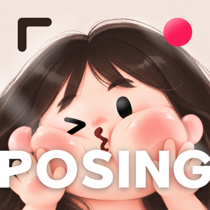

<p align="center">
  
</p>

<div>

## 📸 POSING

> **"Strike a pose, nail the shot." <br> 포즈 가이드를 겹쳐 보며, 원하는 구도 그대로 찍다.**

</div>

<br>

## 📌 포징은 이런 앱이에요

> 여행지에서 다른 사람에게 사진을 부탁하면 원하는 구도를 말로 설명하기 어렵고, 결과물도 매번 달라진다. 포징은 아이폰 기본 카메라와 똑같은 화면에 **포즈 테두리**나 **내가 고른 참고 사진**을 반투명하게 겹쳐 보여줘서, 찍어주는 사람이 화면만 보고 같은 구도로 찍을 수 있게 하기 위해 만들었다.

### 🔥 기본 카메라 그대로

> 처음 써보는 사람도 설명 없이 바로 찍을 수 있습니다

아이폰 기본 카메라(iOS 26)와 같은 배치·아이콘·동작을 그대로 따랐다. 앱을 켜면 홈 화면 없이 바로 카메라가 나오고, 찍은 사진·영상은 아이폰 사진 앱에 바로 저장된다. 기본 카메라에 더한 건 상단 왼쪽 **초기화 · 포즈 · MY** 버튼 3개와 셔터 왼쪽 **카메라 버튼**뿐이다.

### 🔥 포즈 · MY 레이어

> 포즈 테두리와 참고 사진을 화면에 겹쳐 구도를 맞춥니다

- **포즈**: 미리 넣어 둔 포즈 테두리를 겹쳐 보여준다 (기본 투명도 100%)
- **MY**: 꾹 눌러 사진 앱에서 고른 사진을 반투명하게 겹친다 (기본 투명도 35%)
- 포즈 1개 + MY 1개까지 동시에 겹칠 수 있고, 손가락으로 크기·위치를 조절한다
- 겹친 레이어는 **화면에만** 보이고, 저장되는 사진·영상에는 **절대** 들어가지 않는다

### 🔥 카메라별 색감 · 스타일

> 카메라 기종을 고르면 그 카메라의 사진 느낌으로 찍힙니다

셔터 왼쪽 카메라 버튼으로 기종(예: IXUS 750)을 고르면 그 색감이 미리보기와 사진에 적용된다. 기본 카메라의 사진 스타일과 같은 화면·조작으로 톤·색상·팔레트도 조절할 수 있다.

### 🔥 완전 오프라인

> 인터넷 없이 모든 기능이 동작합니다

촬영, 저장, 포즈·MY, 설정까지 비행기 모드에서도 전부 쓸 수 있다. 네트워크 코드와 외부 라이브러리를 쓰지 않는다.

<br>

## 👤 POSING을 만든 사람

| 역할 | 담당 |
|:---|:---|
| 📱 iOS | 배서윤 |
| 🎨 Design | 배서윤 |

<br>

## ⚙️ 기술 스택

| 구분 | 기술 | 용도 |
| --- | --- | --- |
| Language |  | App |
| UI |  | 카메라 화면 · 패널 · 설정 화면 |
| Camera |  | 촬영 · 녹화 · 배율 · 초점 (애플 [AVCam](https://developer.apple.com/documentation/avfoundation/avcam-building-a-camera-app) 예제 기반) |
| Image |   | 스타일 · 카메라 색감 보정, 비율 자르기 (EXIF 유지) |
| Photos |  | 사진 앱 저장, MY 사진 고르기 |
| Sensor |  | 수평계 |
| IDE |  | 빌드 · 서명 · 기기 설치 |
| Review |  | PR 코드 리뷰 |

<br>

## ⚙️ 실행 환경

- **대상 기기**: iPhone 16 Pro (세로 고정)
- **최소 iOS**: `26.0`
- **외부 라이브러리**: 없음 (애플 기본 프레임워크만 사용)
- **여는 방법**
  ```bash
  git clone https://github.com/seooyoon/POSING.git
  cd POSING
  ```
  Xcode로 프로젝트를 열고 **Signing & Capabilities**에서 Team과 Bundle Identifier를 내 계정으로 바꿉니다.

- **실행**: 아이폰을 연결하고 Xcode에서 ▶
  > 시뮬레이터에는 카메라가 없어서 샘플 이미지로 화면만 확인할 수 있습니다. 카메라 동작은 실기기에서 확인합니다.
  > 무료 애플 ID로 설치하면 7일 동안 유지됩니다.

<br>

## 🔗 Git Convention

### 1️⃣ Git Flow

```
  main ← develop ← feature 브랜치
```

- `main branch` : 배포 브랜치 (여행 전 폰에 설치하는 버전)
- `develop branch` : 개발 브랜치, 작업 브랜치가 merge됨
- `feat / fix / chore / refactor ...` : 작업 브랜치

  <br/>

### 2️⃣ Flow

- 이슈 생성 (로드맵 단계 포함, 예: `[2단계] 포즈 · MY 레이어`)
- 이슈 번호에 맞게 `develop` 브랜치에서 새로운 브랜치 생성
- 작업 완료 후 커밋 컨벤션에 맞게 커밋
- PR 생성 (PR 템플릿의 절대 규칙 체크리스트 확인)
- CodeRabbit 리뷰 반영 + 실기기 확인 후 `develop` 브랜치로 병합
- `main`, `develop`에는 직접 push하지 않음

  <br/>

### 3️⃣ Branch Naming Convention

- **구조**: `브랜치종류/#이슈번호-기능설명`
- **구분자**: 하이픈(`-`) 사용
- **예시**: `feat/#3-pose-layer`, `fix/#12-zoom-dial`

| Prefix     | 설명               |
| ---------- | ------------------ |
| `init`     | 초기 프로젝트 세팅 |
| `feat`     | 새로운 기능 추가   |
| `fix`      | 버그 수정          |
| `docs`     | 문서 변경          |
| `style`    | UI 수정            |
| `refactor` | 코드 리팩토링      |
| `test`     | 테스트 코드 관련   |
| `chore`    | 설정 파일 변경     |
| `security` | 보안약점 조치      |
| `hotfix`   | 긴급한 버그 수정   |
| `deploy`   | 배포 관련 작업     |

  <br/>

### 4️⃣ Commit Message

- **구조**: `prefix: 내용 (#이슈번호)`
- **예시**
  - `init: AVCam 예제 프로젝트 추가 (#1)`
  - `feat: 포즈 패널과 투명도 조절 바 구현 (#3)`
  - `fix: 1:1 비율 저장 시 EXIF 누락 수정 (#12)`

| Prefix     | 설명               |
| ---------- | ------------------ |
| `init`     | 초기 프로젝트 세팅 |
| `feat`     | 새로운 기능 추가   |
| `fix`      | 버그 수정          |
| `docs`     | 문서 변경          |
| `style`    | UI 수정            |
| `refactor` | 코드 리팩토링      |
| `test`     | 테스트 코드 관련   |
| `chore`    | 설정 파일 변경     |
| `security` | 보안약점 조치      |
| `hotfix`   | 긴급한 버그 수정   |
| `deploy`   | 배포 관련 작업     |

  <br/>

## 📂 프로젝트 구조

```
📦 POSING
├─ 📁 .github
│  ├─ 📁 ISSUE_TEMPLATE
│  │  ├─ 📄 feat.md              # [FEAT] 이슈 템플릿
│  │  ├─ 📄 bug.md               # [BUG] 이슈 템플릿
│  │  ├─ 📄 chore.md             # [CHORE] 이슈 템플릿
│  │  └─ 📄 docs.md              # [DOCS] 이슈 템플릿
│  └─ 📄 pull_request_template.md
├─ 📄 .coderabbit.yaml           # CodeRabbit 리뷰 언어/설정
├─ 📄 .gitignore
├─ 📄 CLAUDE.md                  # 개발 지시서 (절대 규칙, 임시 기본값)
├─ 📁 docs
│  ├─ 📄 01_SPEC.md              # 기능 명세
│  ├─ 📄 02_UI.md                # 화면 배치와 동작
│  ├─ 📄 03_ROADMAP.md           # 개발 단계
│  ├─ 📄 04_ASSETS.md            # 포즈 · 아이콘 · 카메라 규격
│  ├─ 📄 05_TECH_NOTES.md        # 기술 메모
│  └─ 📁 reference               # 기본 카메라 참고 스크린샷
├─ 📄 LICENSE-AVCam.txt          # 애플 AVCam 예제 라이선스
├─ 📁 Configuration              # 샘플 코드 빌드 설정 (xcconfig)
├─ 📄 AVCam.xcodeproj            # Xcode 프로젝트
├─ 📁 AVCam                      # 앱 본체 (애플 AVCam 예제 기반)
│  ├─ 📄 AVCamApp.swift           # 앱 시작점
│  ├─ 📄 CameraModel.swift        # 화면과 촬영 서비스를 잇는 모델
│  ├─ 📄 CaptureService.swift     # 카메라 세션 (actor, 메인 스레드 밖)
│  ├─ 📁 Capture                  # 사진 · 동영상 촬영
│  ├─ 📁 Model                    # 상태 · 데이터 타입 · 사진 앱 저장
│  ├─ 📁 Views                    # 카메라 화면 · 툴바 · 오버레이
│  ├─ 📁 Support                  # 확장 함수
│  └─ 📁 Preview Content          # 시뮬레이터 · 프리뷰용 가짜 카메라
├─ 📁 AVCamCaptureExtension       # 잠금화면 카메라 확장
└─ 📁 AVCamControlCenterExtension # 제어 센터 · 카메라 컨트롤 위젯
```
